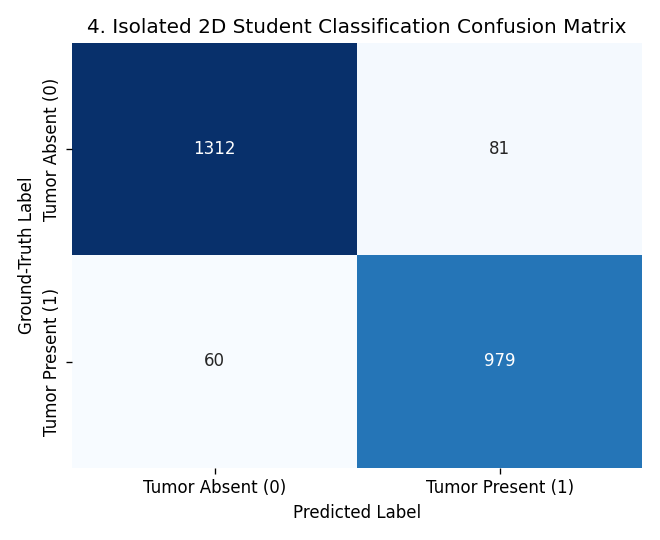
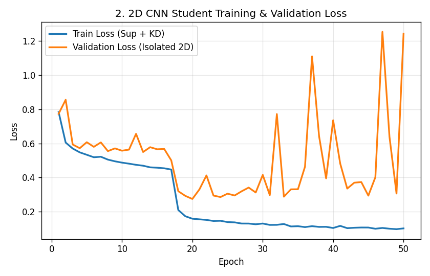
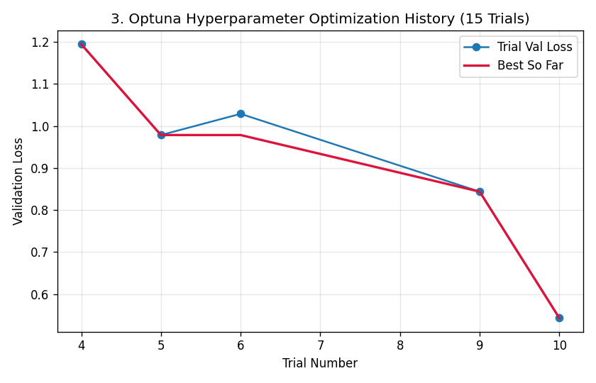
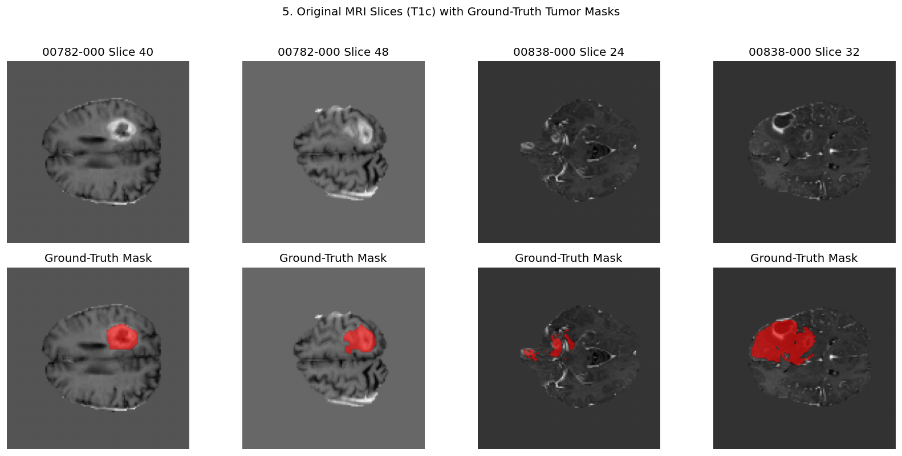
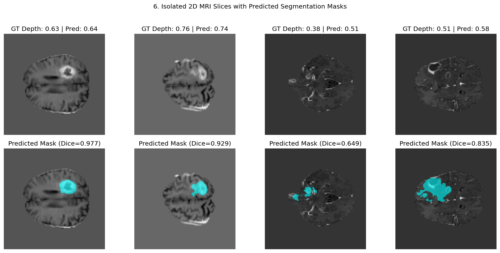
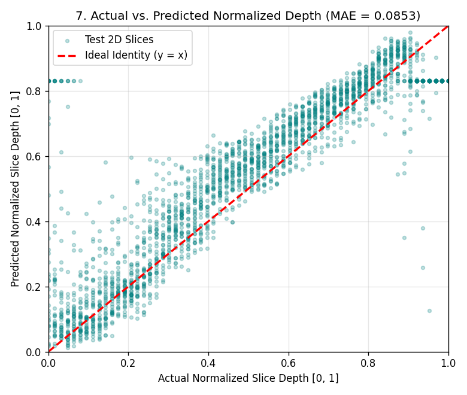
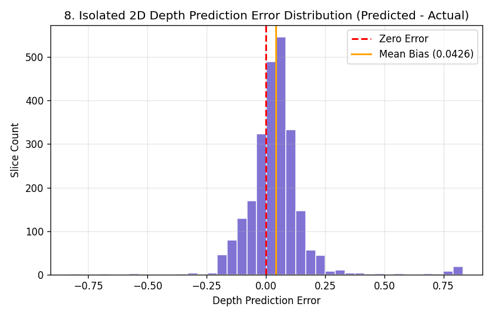
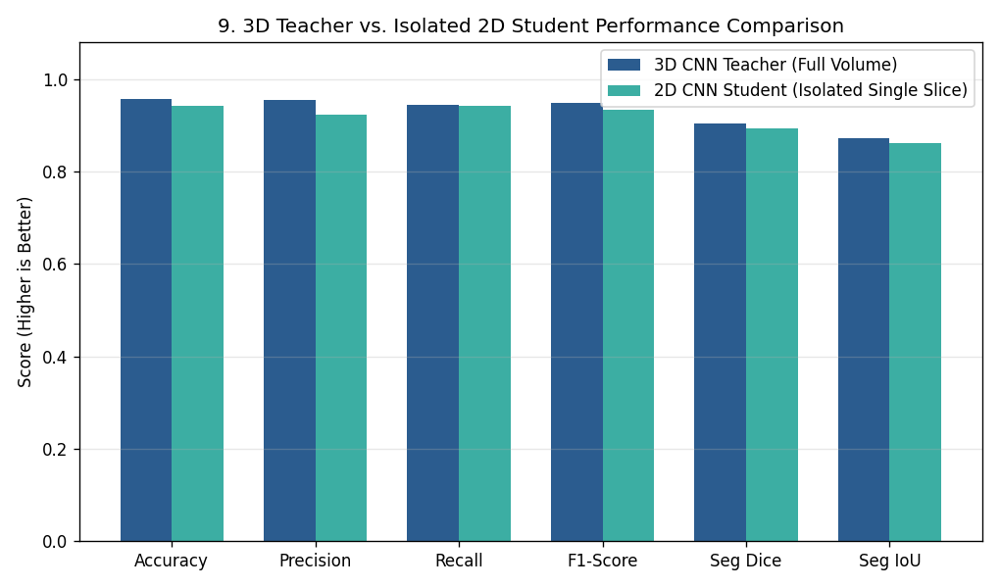

# NeuroLens V2
### From 3D Volumetric Intelligence to 2D Slice-Level Prediction

**Cross-Dimensional Knowledge Transfer for Brain Tumor Classification, Segmentation, and Spatial Depth Estimation**

<p align="center">
  <strong>One volumetric teacher. One slice-level student. Three prediction tasks. One fundamental research question.</strong>
</p>

---

## The Research Question

**Can a model learn to understand the brain in three dimensions and transfer that knowledge to another model that sees only one MRI slice at a time?**

NeuroLens V2 investigates this question through a 3D-to-2D teacher–student learning framework.

A 3D Convolutional Neural Network (CNN) teacher learns from multi-modal volumetric brain MRI data. Its learned knowledge guides a 2D CNN student through supervised learning and knowledge distillation. The student is then evaluated on individual MRI slices for tumor classification, segmentation, and spatial depth estimation.

The central idea is to investigate whether useful spatial representations acquired from an entire MRI volume can be transferred to a model that operates on isolated two-dimensional images.

**The ambition is not simply to build another brain tumor classifier. It is to investigate whether volumetric knowledge can survive a change in dimensionality.**

---

## Research Hypothesis

### H₁ — Cross-Dimensional Knowledge Transfer

A 3D CNN teacher trained on volumetric multi-modal brain MRI can guide a 2D CNN student through supervised learning and knowledge distillation, enabling the student to perform tumor classification, tumor segmentation, and normalized axial depth estimation using isolated MRI slices, while achieving performance approaching that of the volumetric teacher on the evaluated tasks.

<details>
<summary><strong>Why this hypothesis matters</strong></summary>

A 3D model has access to spatial relationships across neighbouring MRI slices. A 2D model, when given an isolated slice, does not directly observe that complete volumetric context.

This creates a representation gap between the two learning settings.

NeuroLens V2 investigates whether teacher-guided learning can help the 2D student acquire useful predictive capabilities without requiring a complete volume at inference time.

The hypothesis therefore concerns more than prediction accuracy. It concerns the transfer of useful knowledge across different input dimensions.

</details>

### Hypothesis verdict

<kbd>Supported by current experimental evidence</kbd>

The current experiments provide evidence supporting the feasibility of cross-dimensional knowledge transfer:

- The isolated 2D student demonstrates strong binary tumor classification results on the evaluated samples.
- The student produces meaningful tumor segmentation masks, including examples with high Dice scores.
- The depth-estimation task achieves a reported mean absolute error of 0.0853.
- The reported teacher–student comparison shows the 2D student approaching the 3D teacher on the displayed classification and segmentation metrics.

This supports the central research hypothesis within the scope of the experiments conducted.

It does **not** establish complete equivalence between 2D and 3D models, nor does it establish clinical validity or generalization to every MRI population. Further independent validation and training-stability analysis remain necessary.

---

## 1. The Problem: Volumetric Context vs. Isolated Slices

Brain MRI is inherently spatial. A tumor may extend across multiple slices, and its appearance can change considerably depending on the imaging plane and anatomical position.

Three-dimensional models can learn from the relationships between slices, but they generally require volumetric inputs and greater computational resources.

Two-dimensional models can process individual images more easily, but an isolated slice provides incomplete information about the full anatomical structure.

This creates an important research challenge:

| 3D Volumetric Learning | 2D Slice-Level Learning |
|---|---|
| Processes complete MRI volumes | Processes individual MRI slices |
| Captures inter-slice spatial context | Observes local slice-level information |
| Can learn volumetric representations | Learns representations from individual images |
| Requires volumetric input | Can operate without a complete volume at inference |
| Often computationally more demanding | Offers a potentially lighter inference setting |

NeuroLens V2 explores a bridge between these two approaches.

Instead of training the 2D model independently and expecting it to rediscover all useful representations, the project investigates whether a 3D teacher can guide its learning.

---

## 2. Proposed Architecture

### The 3D Teacher–2D Student Framework

The framework contains two complementary neural networks connected through knowledge distillation.

```text
             BraTS 2023 GLI
          Multi-modal MRI Volumes
             T1n | T1c | T2w | T2f
                      |
                      v
             +------------------+
             |   3D CNN TEACHER |
             |                  |
             | Volumetric       |
             | Feature Learning |
             +------------------+
                      |
              Teacher Guidance
                      |
                      v
             +------------------+
             | Knowledge        |
             | Distillation     |
             +------------------+
                      |
                      v
Individual MRI Slices ---> 2D CNN STUDENT
                              |
                 +------------+------------+
                 |            |            |
                 v            v            v
             Tumor         Tumor       Normalized
          Classification Segmentation  Depth Estimation
```

### 2.1 The 3D CNN Teacher

The teacher is trained using volumetric MRI data from the BraTS 2023 Adult Glioma dataset.

It receives four MRI modalities:

| Modality | Description |
|---|---|
| T1n | Native T1 |
| T1c | Contrast-enhanced T1 |
| T2w | T2-weighted |
| T2f | T2-FLAIR |

The teacher learns from volumetric information, allowing it to process spatial relationships across the MRI volume.

Its purpose is to provide a richer learning signal to the student.

### 2.2 The 2D CNN Student

The student operates on individual MRI slices rather than requiring a complete 3D volume.

It is trained through supervised learning and teacher-guided knowledge distillation.

The student supports three prediction objectives:

| Task | Input | Prediction |
|---|---|---|
| Classification | Individual MRI slice | Tumor absent / tumor present |
| Segmentation | Individual MRI slice | Pixel-wise tumor mask |
| Depth estimation | Individual MRI slice | Normalized axial position |

The three objectives allow the project to investigate whether transferred knowledge supports different types of slice-level prediction rather than classification alone.

### 2.3 Knowledge Distillation

Knowledge distillation connects the teacher and student learning processes.

A general representation of the student training objective is:

\[
\mathcal{L}_{student}
=
\mathcal{L}_{supervised}
+
\lambda_{KD}\mathcal{L}_{KD}
\]

where:

- \(\mathcal{L}_{supervised}\) represents task-specific supervised learning.
- \(\mathcal{L}_{KD}\) represents the knowledge-distillation objective.
- \(\lambda_{KD}\) controls the contribution of the distillation term.

The purpose is to combine direct task supervision with information transferred from the teacher.

The exact loss components, feature alignment operations, and weighting are defined by the implementation and experiment configuration.

---

## 3. Dataset Strategy

NeuroLens V2 uses two datasets with distinct experimental roles.

### 3.1 BraTS 2023 – Adult Glioma

<kbd>Primary volumetric dataset</kbd>

BraTS 2023 GLI provides multi-modal brain MRI volumes and corresponding tumor annotations.

| Property | Description |
|---|---|
| Dataset | BraTS 2023 GLI |
| Imaging type | 3D volumetric MRI |
| Modalities | T1n, T1c, T2w, T2f |
| Primary role | 3D teacher training and evaluation |
| Annotations | Tumor segmentation labels |

The segmentation labels include:

| Label | Meaning |
|---|---|
| 0 | Background |
| 1 | Necrotic / non-enhancing tumor core |
| 2 | Peritumoral edema |
| 3 | Enhancing tumor |

**Official dataset access:** [BraTS 2023 GLI – Synapse](https://www.synapse.org/#!Synapse:syn51156910)

Access may require registration, authorization, and agreement to the dataset's usage conditions.

### 3.2 BRISC 2025

<kbd>Independent external 2D dataset</kbd>

BRISC 2025 is used as an independent dataset for evaluating the 2D learning pipeline.

| Property | Description |
|---|---|
| Dataset | BRISC 2025 |
| Imaging type | 2D MRI |
| Modality | T1 |
| Classification categories | Glioma, meningioma, no tumor, pituitary |
| Primary role | External 2D evaluation |

An important distinction: BRISC 2025 is an independent 2D dataset, not a paired volumetric extension of BraTS.

The BRISC T1 data are evaluated as provided. Missing MRI modalities are not synthetically fabricated.

**Dataset access:** [BRISC 2025 – Kaggle](https://www.kaggle.com/datasets/briscdataset/brisc2025)

**Associated publication:** [BRISC 2025 – Scientific Data](https://www.nature.com/articles/s41597-026-06753-y)

### Why two datasets?

BraTS provides the volumetric setting required for the teacher-learning stage, while BRISC provides an independent 2D evaluation setting.

Together, they allow the research to investigate volumetric learning, slice-level prediction, and performance under a different dataset setting.

**The datasets serve different purposes; their results should not be interpreted as a direct paired comparison.**

---

## 4. Experimental Results

The experimental results are the central evidence used to assess the research hypothesis.

The repository includes quantitative CSV files and selected visualizations so that the findings can be inspected beyond a single headline metric.

### 4.1 Isolated 2D Student Classification



The displayed confusion matrix provides the following counts:

| Classification outcome | Count |
|---|---:|
| True negatives | 1,312 |
| False positives | 81 |
| False negatives | 60 |
| True positives | 979 |

From these counts:

\[
Accuracy = \frac{TP+TN}{TP+TN+FP+FN}
\]

\[
Accuracy = \frac{979+1312}{2432}
\approx 94.28\%
\]

\[
Precision = \frac{979}{979+81}
\approx 92.36\%
\]

\[
Recall = \frac{979}{979+60}
\approx 94.23\%
\]

\[
F1 = \frac{2TP}{2TP+FP+FN}
\approx 93.29\%
\]

These calculations describe the displayed confusion matrix and its corresponding evaluation samples.

### 4.2 2D Student Training Behaviour



The student training curve shows a substantial decrease in training loss over the recorded epochs.

The validation curve, however, exhibits considerable fluctuations and several sharp increases.

This distinction matters: decreasing training loss alone does not establish stable generalization. The validation behaviour should be considered when interpreting the model's performance.

### 4.3 Hyperparameter Optimization



The optimization history shows validation loss across the displayed Optuna trials.

The lowest displayed trial validation loss is approximately 0.545.

This figure documents the optimization process and the best observed value among the displayed trials. It should not be interpreted as a guarantee of optimal generalization.

### 4.4 Ground-Truth Tumor Segmentation



The selected examples show original MRI slices alongside their ground-truth tumor masks.

These examples provide the reference against which the student segmentation predictions can be visually inspected.

### 4.5 Predicted 2D Tumor Segmentation



The displayed examples show the student producing segmentation masks from isolated MRI slices.

Reported Dice scores for the four displayed examples are:

| Example | Dice score |
|---|---:|
| 1 | 0.977 |
| 2 | 0.929 |
| 3 | 0.649 |
| 4 | 0.835 |

These are selected example-level results, not an aggregate test-set Dice score.

The variation between examples also illustrates why qualitative inspection and aggregate evaluation are both important.

### 4.6 Spatial Depth Estimation



The student estimates normalized axial slice depth in the interval:

\[
d \in [0,1]
\]

The scatter plot compares actual and predicted depth. The diagonal reference line represents ideal prediction.

The reported evaluation is:

<kbd>MAE = 0.0853</kbd>



The depth prediction error is defined as:

\[
e_i = \hat{d}_i-d_i
\]

where \(d_i\) is the actual normalized depth and \(\hat{d}_i\) is the predicted depth.

| Metric | Reported value |
|---|---:|
| Mean Absolute Error | 0.0853 |
| Mean Bias | 0.0426 |

This experiment investigates whether the student can estimate spatial position from an individual slice without receiving the complete volume as input.

### 4.7 3D Teacher vs. 2D Student



The comparison evaluates six performance measures:

- Accuracy
- Precision
- Recall
- F1-score
- Segmentation Dice
- Segmentation IoU

The plotted results show the 2D student approaching the 3D teacher across the displayed measures.

This is an important observation because the student operates on individual slices while the teacher processes complete volumes.

However, a visual comparison does not establish statistical equivalence or prove that the student retains all volumetric information.

The detailed numerical outputs are available in the [`results/`](results/README.md) directory.

---

## 5. Does the Evidence Support the Hypothesis?

The central hypothesis is that teacher-guided learning can transfer useful volumetric knowledge to a 2D model that operates on isolated MRI slices.

The current experimental evidence supports this hypothesis across the three prediction objectives.

| Hypothesis component | Experimental evidence | Assessment |
|---|---|---|
| Isolated-slice classification | Confusion matrix with approximately 94.28% accuracy | Supported |
| Isolated-slice segmentation | Predicted masks with encouraging example Dice scores | Supported by selected examples |
| Spatial depth estimation | MAE of 0.0853 | Supported |
| Teacher–student performance | Student approaches teacher on displayed metrics | Supported by reported comparison |
| Independent 2D evaluation | BRISC evaluation results recorded separately | Requires interpretation of full external results |

### Overall interpretation

The experiments demonstrate that the 2D student can perform the intended prediction tasks using individual MRI slices.

The results are consistent with the proposed idea that knowledge learned in a volumetric setting can support slice-level prediction.

**Therefore, the central NeuroLens V2 hypothesis is supported by the current experimental evidence, within the scope of the evaluated datasets and experiments.**

This conclusion should not be confused with proof of complete 2D–3D equivalence, universal generalization, or clinical readiness.

---

## 6. Repository Structure

The repository is organised to separate implementation, experimentation, quantitative outputs, and visual evidence.

```text
NeuroLens-V2/
│
├── neurolens/
│   ├── config.py
│   │
│   ├── models/
│   │   ├── multitask.py
│   │   ├── alignment.py
│   │   ├── encoder2d.py
│   │   └── encoder3d.py
│   │
│   ├── datasets/
│   │   ├── brisc.py
│   │   ├── brats.py
│   │   └── transforms.py
│   │
│   ├── training/
│   │   ├── trainer.py
│   │   └── train.py
│   │
│   ├── evaluation/
│   │   ├── segmentation.py
│   │   ├── classification.py
│   │   ├── alignment.py
│   │   └── visualization.py
│   │
│   ├── losses/
│   └── utils/
│
├── notebooks/
│   ├── NeuroLens_V2_3D_to_2D_Generalization.ipynb
│   └── NeuroLens_V2_3D_to_2D_Generalization_Placeholder_Paths.ipynb
│
├── results/
│   ├── README.md
│   ├── final_comparison.csv
│   ├── 3d_results.csv
│   ├── isolated_2d_results.csv
│   ├── brisc_results.csv
│   └── depth_results.csv
│
├── visualizations/
│   ├── README.md
│   ├── 02_student_loss_curves.png
│   ├── 03_optuna_history.png
│   ├── 04_confusion_matrix.png
│   ├── 05_gt_slices_and_masks.png
│   ├── 06_predicted_2d_segmentation.png
│   ├── 07_actual_vs_predicted_depth.png
│   ├── 08_depth_error_distribution.png
│   └── 09_teacher_vs_student_comparison.png
│
├── config.yaml
├── requirements.txt
├── LICENSE
├── .gitignore
└── README.md
```

Only include files and directories that actually exist in the public repository.

---

## 7. Notebooks

Two notebook versions are provided.

| Notebook | Purpose |
|---|---|
| `NeuroLens_V2_3D_to_2D_Generalization.ipynb` | Executed notebook containing experimental outputs, visualizations, and recorded results. |
| `NeuroLens_V2_3D_to_2D_Generalization_Placeholder_Paths.ipynb` | Reproducibility version with configurable placeholder paths for connecting datasets in another environment. |

The two notebooks document the same research pipeline. One preserves the executed experimental work; the other allows users to adapt the paths to their own environment.

---

## 8. Reproducing the Experiments

NeuroLens V2 is designed to be explored through its notebooks and Python implementation.

### Requirements

- Python
- PyTorch
- NumPy
- Pandas
- Scikit-learn
- Scientific and image-processing dependencies listed in `requirements.txt`
- GPU-enabled runtime recommended for volumetric model training

### Step 1 – Clone the repository

```bash
git clone https://github.com/MSSG-07/NeuroLens-V2.git
cd NeuroLens-V2
```

### Step 2 – Install dependencies

```bash
pip install -r requirements.txt
```

### Step 3 – Download the datasets

Obtain the datasets from their respective official access pages:

- [BraTS 2023 GLI](https://www.synapse.org/#!Synapse:syn51156910)
- [BRISC 2025](https://www.kaggle.com/datasets/briscdataset/brisc2025)

The raw MRI data are not distributed through this repository.

### Step 4 – Prepare the expected data structure

The current notebook configuration expects the following Google Drive organisation:

```text
MyDrive/
│
├── NeuroLens/
│   ├── data/
│   │   └── raw/
│   │       ├── BraTS2023/
│   │       │   └── ASNR-MICCAI-BraTS2023-GLI-Challenge-TrainingData/
│   │       │
│   │       └── BRISC2025/
│   │           └── brisc2025/
│   │
│   └── manifests/
│       ├── train.csv
│       ├── validation.csv
│       └── test.csv
│
└── Neuropense version 2/
```

### Step 5 – Prepare the manifests

The notebook requires three manifest CSV files:

- `train.csv`
- `validation.csv`
- `test.csv`

These files provide the records and split information used by the experimental pipeline.

Downloading the MRI datasets alone is not sufficient. The manifests must also be prepared in the format expected by the notebook's data-loading code, including valid dataset paths and the required metadata fields.

The manifest files are not included as a replacement for the raw MRI data.

Before running the experiments, inspect the manifest-loading and validation sections of the notebook and ensure the files match the expected schema.

### Step 6 – Configure paths

Update the dataset, manifest, and output paths in the notebook configuration to match your environment.

The current output workspace is:

```text
/content/drive/MyDrive/Neuropense version 2
```

### Step 7 – Run the notebook

Open the placeholder-path notebook in Google Colab.

1. Connect Google Drive.
2. Configure the dataset and manifest paths.
3. Verify that all required inputs are accessible.
4. Confirm the runtime dependencies.
5. Execute the notebook cells in order.
6. Inspect the generated results and visualizations.

The experiment pipeline creates its output directories automatically.

---

## 9. Experimental Output Directories

The notebook generates its outputs in a separate workspace.

```text
Neuropense version 2/
│
├── checkpoints/
├── optuna/
├── results/
├── predictions/
│   ├── classification/
│   ├── segmentation/
│   └── depth/
├── visualizations/
└── logs/
```

| Directory | Purpose |
|---|---|
| `checkpoints/` | Saved model weights and checkpoints |
| `optuna/` | Hyperparameter optimization records |
| `results/` | Quantitative evaluation outputs |
| `predictions/` | Classification, segmentation, and depth predictions |
| `visualizations/` | Generated research figures |
| `logs/` | Training and experiment logs |

The public repository contains selected research results and figures rather than every intermediate training artifact.

---

## 10. Limitations and Research Considerations

A research result is meaningful only when its limitations are equally visible.

NeuroLens V2 has several important considerations:

**Validation stability:** The student training loss decreases, but the validation loss exhibits substantial fluctuations. Further investigation into generalization and optimization stability is necessary.

**Incomplete volumetric context:** An isolated 2D slice does not contain the full spatial information available to a 3D volume. Knowledge transfer cannot be assumed to recover all missing context.

**External dataset differences:** BRISC 2025 and BraTS 2023 have different data structures and imaging settings. Their results must be interpreted within their respective evaluation protocols.

**Depth estimation:** Normalized axial depth estimates slice position within the defined experimental representation. It should not be interpreted as direct anatomical localization.

**Selected qualitative examples:** High Dice scores on individual examples do not establish high aggregate segmentation performance across an entire test set.

**Clinical validity:** NeuroLens V2 is an experimental research implementation, not a clinically validated diagnostic tool.

---

## 11. Future Research Directions

The current work opens several directions for further investigation:

- More robust shared representation learning across 2D and 3D feature spaces.
- Improved teacher–student feature alignment.
- More stable multitask optimization and validation behaviour.
- Extensive ablation studies to isolate the contribution of knowledge distillation.
- Independent external evaluation across additional MRI datasets.
- Better spatial consistency across neighbouring slice predictions.
- Computational efficiency analysis and inference-time comparison.
- Uncertainty estimation and robustness analysis.

These are proposed extensions and should not be interpreted as completed features of the current implementation.

---

## 12. Citation and Acknowledgements

If you use NeuroLens V2, build upon its implementation, or reference its experimental approach, please acknowledge the project and cite the original datasets and their publications.

**Project:** NeuroLens V2  
**Repository:** [github.com/MSSG-07/NeuroLens-V2](https://github.com/MSSG-07/NeuroLens-V2)

**Datasets:**

- [BraTS 2023 GLI – Official Synapse Repository](https://www.synapse.org/#!Synapse:syn51156910)
- [BRISC 2025 – Kaggle](https://www.kaggle.com/datasets/briscdataset/brisc2025)
- [BRISC 2025 – Scientific Data Publication](https://www.nature.com/articles/s41597-026-06753-y)

Please follow the original dataset providers' citation, licensing, access, and usage requirements.

## 13. License

This project is distributed under the terms specified in the repository's `LICENSE` file.

The licenses and access conditions of the external datasets remain independent of the project's software license.

---

## The Bigger Picture

NeuroLens V2 is built around a question that sits at the intersection of representation learning, medical imaging, and knowledge distillation:

**How much of what a model learns from an entire brain volume can be retained when it is asked to reason from just one slice?**

The experiments suggest that the answer is not necessarily zero.

Through volumetric teacher learning, cross-dimensional knowledge transfer, and multitask slice-level prediction, NeuroLens V2 provides experimental evidence that a 2D student can acquire useful capabilities from a 3D teacher.

The current results support the proposed hypothesis while leaving important questions about generalization, stability, and spatial consistency open for further research.

**NeuroLens V2 — Learning beyond dimensions. Predicting beyond the volume.**
